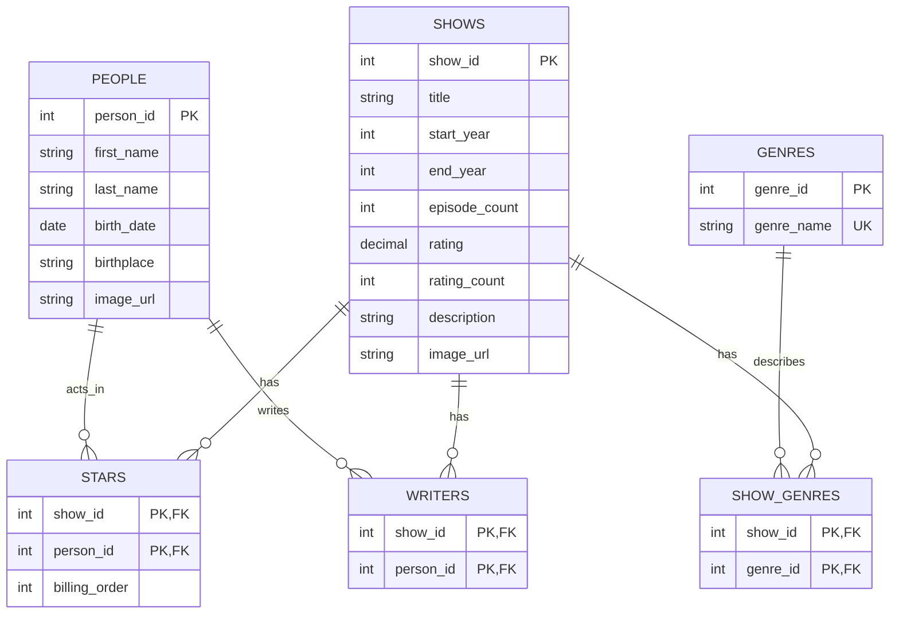

# TV Show Database

The database stores information for a TV show catalog: shows, the people who
act in or write them, and their genres.

## Assumptions

- A person can be both an actor and a writer, so both credits use the same people table.
- A show can have several actors and writers, and a person can work on several shows.
- A show can have no actors, such as a documentary.
- A show can have several genres, and a genre can apply to several shows.
- Episode count and the show's overall rating are columns of shows. Individual
  episodes and individual users' ratings are outside this version.
- There is one overall acting credit and one overall writing credit per person
  per show. Credits are not tracked by episode.
- An image is stored as a URL rather than as the image file itself.

## ERD

## What One Row Means

- **shows:** One row is one TV show, with its title, years, episode count, and overall rating.
- **people:** One row is one person who can act, write, or do both.
- **stars:** One row is one person's acting credit on one show.
- **writers:** One row is one person's writing credit on one show.
- **genres:** One row is one genre, such as comedy or drama.
- **show_genres:** One row connects one show to one genre.
