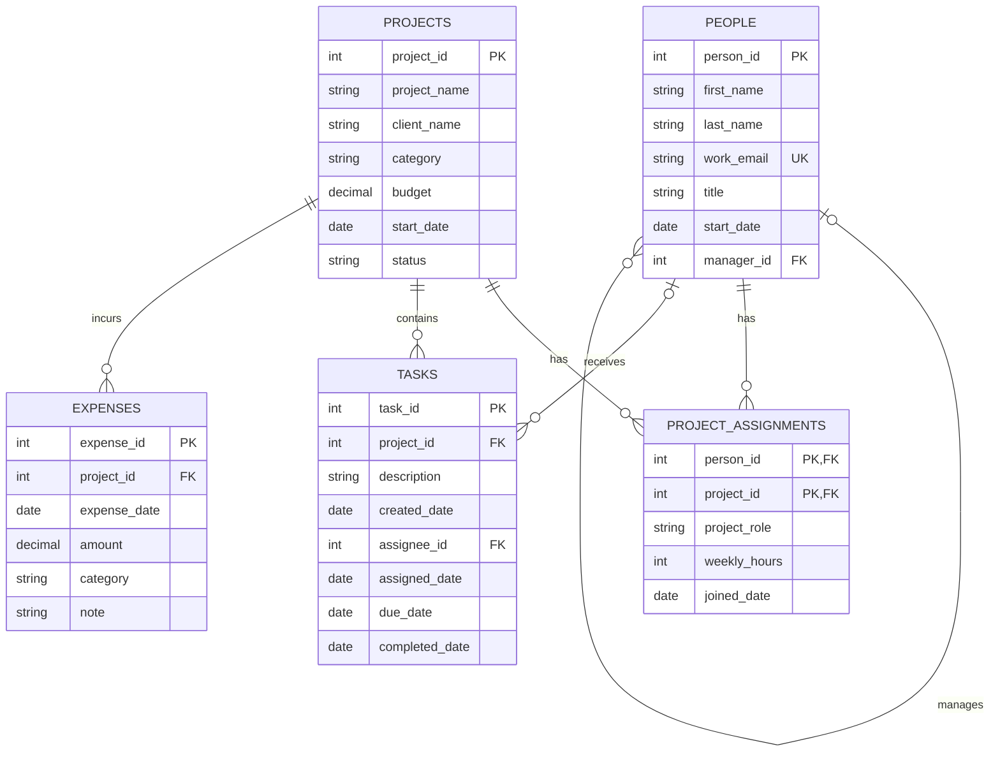

# 1. The Scenario

Scenario A: BabsonAI Labs.

BabsonAI Labs is a startup with about 25 employees that currently tracks
people, projects, staffing, tasks, and expenses in spreadsheets and chat
threads. Its founders want to understand project spending, unfinished
work, and employee workloads.

This database will support the eight business questions listed under
Scenario A in the assignment.

# 2. The ERD

# 3. What One Row Means

people: One row is one employee, with their contact information, job title, start date, and who they report to.

projects: One row is one project, with its client if it has one, category, budget, start date, and current status.

project_assignments: One row is one employee working on one project, including their role, weekly hours, and when they joined it.

tasks: One row is one task for one project, including who it is assigned to, if anyone, and when it was created, assigned, due, and completed.

expenses: One row is one expense for one project, including its date, amount, category, and a short note.

# 4. Design Choices